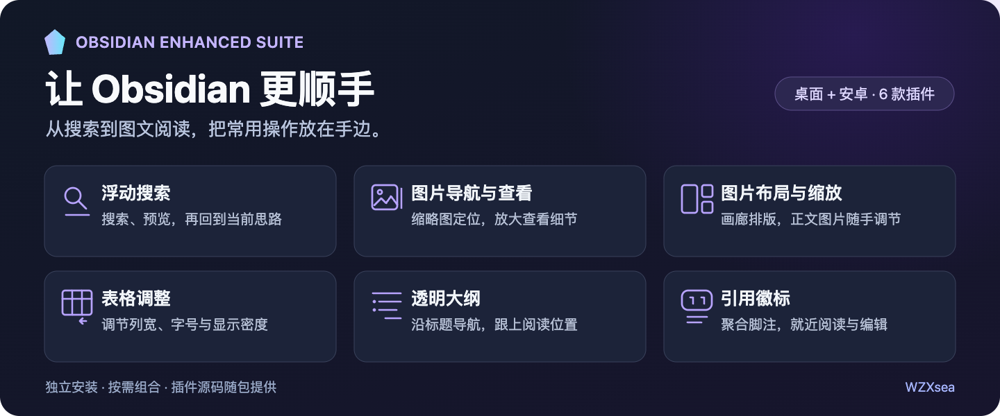

# Obsidian Enhanced Suite

  

Obsidian 插件增强套件 · 桌面 / 安卓手机 / 安卓平板

[【整合包·6合1】Obsidian桌面与安卓全部插件-2026-11-13.zip](https://github.com/WZXsea/obsidian-enhanced-suite/releases/download/images-0.1.9-20261113/Obsidian-ALL-6-Plugins-2026-11-13.zip)

[按需下载单个插件](https://github.com/WZXsea/obsidian-enhanced-suite/releases/tag/images-0.1.9-20261113) · [查看全部版本](https://github.com/WZXsea/obsidian-enhanced-suite/releases) · [反馈问题](https://github.com/WZXsea/obsidian-enhanced-suite/issues)

找资料、看大图、排画廊、调表格、查引用、读长文。把日常阅读和整理中常用的操作，放到手边。

这套工具由 **6 个独立插件**组成，可以整包下载，再按需要选择启用。桌面保留鼠标与键盘操作，安卓手机和平板提供点按、长按和触摸手势。整合包内的插件同时适用于桌面 Obsidian。

## 0.1.9 图片拖动修复

修复 macOS 实时预览中拖动图片时手柄提前消失、调整中断的问题。图片尺寸变化会触发编辑器自动滚动，修复后这类滚动由拖动流程协调，松手后保存本设备宽度。更新时保留原有 data.json，继续沿用各设备尺寸和画廊设置。

## 六个独立插件，按需启用

| 插件 | 能帮你做什么 | 桌面与安卓的使用方式 | 当前版本 |
| --- | --- | --- | --- |
| [Floating Search · 浮动搜索](plugins/float-search/README.md) | 搜文件、标题、别名和正文，展开结果并预览命中内容 | 桌面浮动搜索与预览；手机点按查阅，平板宽屏并排显示结果和预览 | 4.4.4 |
| [Image Toolkit · 图片查看](plugins/obsidian-image-toolkit/README.md) | 悬浮缩略图导航、放大查看、旋转与前后切图 | 桌面鼠标查看；安卓点按打开、双指缩放、单指平移 | 1.4.18 |
| [Image Layouts Enhanced · 图片画廊](plugins/image-layouts-enhanced/README.md) | 正文独立图片居中、拖动调尺寸，组合拼图、瀑布流与主图画廊 | 桌面悬停、手机和平板长按；普通图片尺寸按设备分别保存 | 0.1.9 |
| [Table Column Resize · 表格增强](plugins/table-column-resize/README.md) | 调列宽、整体宽度与字号，一键紧凑排版、合并显示和复制 | 桌面拖动与菜单操作；安卓提供触摸手柄和点按入口 | 1.0.4 |
| [Citation Badges · 引用徽标](plugins/citation-badges/README.md) | 将相邻脚注聚成引用徽标，就近查看、编辑来源并往返定位 | 桌面悬停或点击；安卓点按查看，切换来源正文的预览与编辑 | 0.3.5 |
| [Transparent Outline · 透明大纲](plugins/transparent-outline/README.md) | 文章旁的标题导航、折叠和展开层级调节 | 桌面悬停或常开；安卓点按展开，底部快捷条连接搜索、图片和目录 | 0.3.4 |

## 从你的使用场景开始

### 图多的笔记：排得开，也看得清

Vault 附件和 HTTP(S) 图床图片都能使用。图片画廊支持 Wiki 图片、Markdown 图片、引用式图片与 HTML `img`，可以把相邻图片整理成拼图、瀑布流、横向图片带，或主图搭配缩略图的浏览布局。

普通独立图片默认居中。电脑上把鼠标移到图片旁，手机和平板上长按约 450 毫秒，即可拖动右下角手柄等比调整尺寸；点按“恢复尺寸”回到笔记原有显示。

图片尺寸由各设备独立保存：电脑上放大看细节，平板上调整到适合阅读的宽度。同一个图床链接在笔记中出现多次，也能分别设置大小。调整尺寸时，笔记原文、图床 URL 和已有图片标记保持原样。

图片画廊与 Image Toolkit 搭配使用，可以从排版直接进入大图查看，继续缩放、旋转和切图。

### 查资料：先预览，再打开

Floating Search 把文件、标题、别名和正文检索集中到浮动窗口。点选结果即可查看对应内容，再打开所需笔记。桌面适合边搜边读，平板宽屏可以同时保留结果和预览，手机采用独立阅读预览。

### 读长文：目录和来源都在旁边

透明大纲按标题层级导航，支持单章节折叠和 1–6 层展开。手机和平板可从右缘“目录”按钮、标题栏动作或底部快捷条打开，收起后继续滚动正文。

引用徽标将连续脚注整理成紧凑的编号簇。点击即可查看来源正文、编辑说明或定位脚注定义，再通过命令返回最近引用位置。实时预览、阅读模式和 callout 引用都有对应支持。

### 整理表格：内容和版面一起照顾

一键紧凑排版按内容分配列宽，让短列更紧凑、长文字有更多空间。随后可以继续调整相邻列、整表宽度、对齐和字号，也可对相同内容的单元格进行合并显示。复制时保留 Markdown 原文，桌面还可复制带合并结构的 HTML 富文本。

## 安装与更新

全套使用 Obsidian **1.8.7 或更新版本**。

1. 下载整合包并解压，在包内 `plugins/` 中选择需要的插件文件夹；也可以直接下载对应单插件 ZIP。
2. 关闭 Obsidian，将插件文件夹合并复制到知识库的 `.obsidian/plugins/`，替换同名安装文件，并保留原有 `data.json` 设置文件。安卓文件管理器中可开启“显示隐藏文件”来找到 `.obsidian`。
3. 启动 Obsidian，在“设置 → 第三方插件”中启用所选插件。更新图片画廊后，将该插件关闭再开启一次，以重新加载代码。
4. 使用过 `obsidian-image-center` CSS 片段的用户，可在“设置 → 外观 → CSS 代码片段”中停用旧片段，由图片画廊接管正文图片居中。

组合建议：图片较多时一起启用 Image Layouts Enhanced 与 Image Toolkit；长文阅读可搭配 Floating Search、Citation Badges 和 Transparent Outline；表格增强可按需单独使用。

## 源码、来源与署名

本仓库由 [WZXsea](https://github.com/WZXsea) 整理与维护定制功能、插件联动及安卓适配。发布包的 `plugins/` 提供安装文件，`source/` 保留对应源码与构建输入。

| 组件 | 原作者或实现来源 | 随包许可与说明 |
| --- | --- | --- |
| Floating Search | Boninall / Quorafind · Obsidian Float Search | [GPL-3.0](plugins/float-search/LICENSE)，单插件包同时附对应源码 |
| Image Toolkit | Xiangru / sissilab · Obsidian Image Toolkit | [MIT](plugins/obsidian-image-toolkit/LICENSE) |
| Image Layouts Enhanced | 网格与兼容语法参考 Luke Chadwick / vertis · Image Layouts 0.18.0，扩展正文图片控制与图库联动 | [第三方许可与来源](plugins/image-layouts-enhanced/THIRD-PARTY-NOTICES.md) |
| Table Column Resize | lolieatapple · Table Column Resize，扩展排版、字号、合并显示及触摸控制 | [第三方许可与来源](plugins/table-column-resize/THIRD-PARTY-NOTICES.md) |
| Citation Badges、Transparent Outline | 自建插件；manifest 作者为 weizixun | 各插件 README 与对应源码 |

源码随附，各组件分别授权。上游许可与署名随对应组件保留。功能说明和操作细节可从上方插件名称进入查看，版本更新与安装包集中在 [Releases](https://github.com/WZXsea/obsidian-enhanced-suite/releases)。
